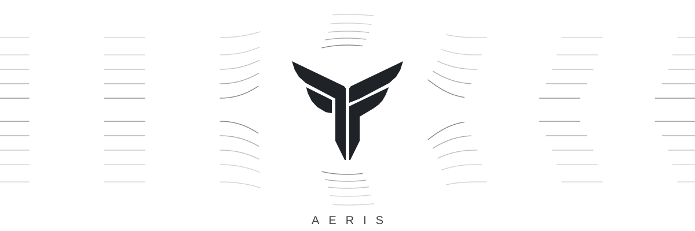

<picture>
  <source media="(prefers-color-scheme: dark)" srcset="media/airflow-dark.svg">
  <source media="(prefers-color-scheme: light)" srcset="media/airflow-light.svg">
  
</picture>

 

We run validators, and we'd rather show you a reading than tell you a story.

Air doesn't announce itself. You notice it by what it moves.

 

<b>I want to delegate</b>

 

Aeris signs on [Archway](https://www.mintscan.io/archway/validators/archwayvaloper1gg6alw26gz6wld3gagz8h6p7e3nu45j7r2sgj8), [ZetaChain](https://www.mintscan.io/zeta/validators/zetavaloper1ev0vrv6hh44hx9gtkn8fyurdxl2w7fk8awztpj), [Band](https://ping.pub/band/staking/bandvaloper1vunu4v046w73sw6xvstfj77uvlevch6u3wngkh) and [Terra](https://ping.pub/terra/staking/terravaloper1ev3kdmq8tgqx4e86gxnyyfsq7uwvvx7y0fts50), and on Celestia's [mocha testnet](https://celestia-dashboard.krews.xyz/celestia-mocha/validators/celestiavaloper1hwh84h98vks52mrslml3np5ffc3u8ym0nypn9g).

Commission, uptime, missed blocks, every governance vote: it's all on-chain. Read it on the explorer, not here. A number on a profile page is a claim. A number on the chain is a reading.

 

<b>I build on Celestia</b>

 

We keep two instruments open, free and without keys.

**[Bridge Pulse](https://aerisvalidator.space/bridge/)** watches every IBC light client Celestia has open, plus the Blobstream bridge to Ethereum. It shows which ones are drifting toward expiry, while it's still a relayer problem and not yet a governance one.

**[Alert Center](https://aerisvalidator.space/alerts/)** puts governance proposals, network upgrades and bridge-health events into one feed, ranked by how much they matter.

Both are plain JSON underneath. Point a bot at [`bridge_monitor.json`](https://aerisvalidator.space/bridge/api/bridge_monitor.json) or [`alerts_feed.json`](https://aerisvalidator.space/alerts/api/alerts_feed.json), or a feed reader at the [RSS](https://aerisvalidator.space/alerts/api/alerts_feed.xml).

 

<b>I want to talk</b>

 

[X / Twitter](https://x.com/AERIS_HANDLE) · [Telegram](https://t.me/AERIS_HANDLE) · [hello@aeris.xyz](mailto:hello@aeris.xyz)

Or start at [aerisvalidator.space](https://aerisvalidator.space/).

 

<b>I'm just looking</b>

 

That's how it starts.

 

