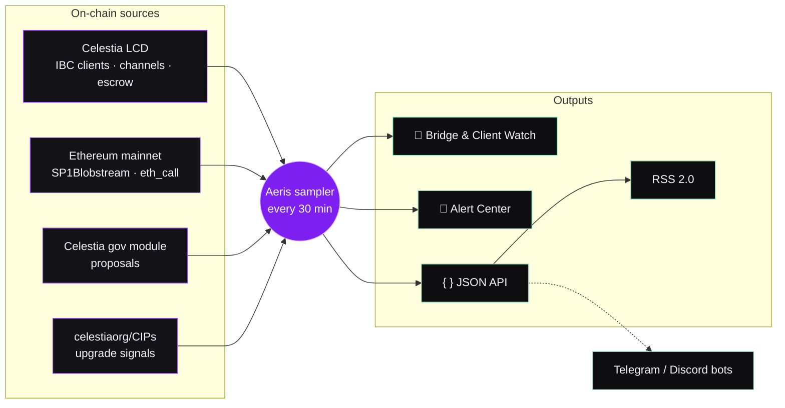

<div align="center">

<a href="https://aerisvalidator.space/"></a>

<br>

[](https://aerisvalidator.space/)
[](https://aerisvalidator.space/bridge/)
[](https://aerisvalidator.space/alerts/)
[](https://aerisvalidator.space/alerts/api/alerts_feed.xml)
[](mailto:hello@aeris.xyz)

**Independent PoS validator & network-monitoring infrastructure.**<br>
Raw readings first — no forecasts, no curated stories.

</div>

---

## 📡 Live readings

<sub>Pulled straight from the Aeris public API — these numbers update themselves (every ~30 min).</sub>

<p align="center">
  <a href="https://aerisvalidator.space/bridge/"></a>
  <a href="https://aerisvalidator.space/bridge/"></a>
  <br>
  <a href="https://aerisvalidator.space/bridge/"></a>
  <a href="https://aerisvalidator.space/bridge/"></a>
  <a href="https://aerisvalidator.space/bridge/"></a>
  <br>
  <a href="https://aerisvalidator.space/alerts/"></a>
  <a href="https://aerisvalidator.space/alerts/"></a>
</p>

## 🛰️ Validators

| | Network | Chain ID | Validator |
|:-:|---|---|---|
|  | **ZetaChain** | `zetachain mainnet` | [](https://www.mintscan.io/zeta/validators/zetavaloper1ev0vrv6hh44hx9gtkn8fyurdxl2w7fk8awztpj) <br><sub>`zetavaloper1ev0vrv6hh44hx9gtkn8fyurdxl2w7fk8awztpj`</sub> |
|  | **Archway** | `archway-1` | [](https://www.mintscan.io/archway/validators/archwayvaloper1gg6alw26gz6wld3gagz8h6p7e3nu45j7r2sgj8) <br><sub>`archwayvaloper1gg6alw26gz6wld3gagz8h6p7e3nu45j7r2sgj8`</sub> |
|  | **Band** | `laozi-mainnet` | [](https://ping.pub/band/staking/bandvaloper1vunu4v046w73sw6xvstfj77uvlevch6u3wngkh) <br><sub>`bandvaloper1vunu4v046w73sw6xvstfj77uvlevch6u3wngkh`</sub> |
|  | **Terra** | `phoenix-1` | [](https://ping.pub/terra/staking/terravaloper1ev3kdmq8tgqx4e86gxnyyfsq7uwvvx7y0fts50) <br><sub>`terravaloper1ev3kdmq8tgqx4e86gxnyyfsq7uwvvx7y0fts50`</sub> |

## 🔭 How the instruments work

Every number Aeris publishes is read live from the chains themselves — no third-party dashboards in between.



## 🌉 Bridge & Client Watch

> **[aerisvalidator.space/bridge →](https://aerisvalidator.space/bridge/)**

Celestia has ~175 IBC light clients open to other chains plus one bridge to Ethereum. A client expires silently if nobody relays a header in time — and recovering it requires a governance vote. Bridge Watch tracks every one of them live, so a problem shows up **before** it becomes a proposal.

| Tab | What it shows |
|---|---|
| **Overview** | Chains actively bridged, chains heading toward expiry, Blobstream lag, TIA locked in live transfer channels |
| **Bridge Pulse** | Live visualization — every dot is a real counterparty chain pulsing at its risk level; particle speed follows the real Blobstream lag |
| **Chains** | IBC clients by counterparty chain: *Healthy · Watch · Critical · Expired*, % of trust window left, abandoned clients counted — not hidden |
| **Blob trend** | Blobstream lag history from Aeris's own 30-min samples, with growth-rate analysis that tells a slow relayer from a fully stalled one |
| **Recent events** | Only real risk-state transitions — no repeated noise |
| **API** | Public JSON behind everything on the page |

Blobstream height is read directly from the SP1Blobstream contract [`0x7Cf3…08fAe`](https://etherscan.io/address/0x7Cf3876F681Dbb6EdA8f6FfC45D66B996Df08fAe) on Ethereum mainnet and cross-checked against Celestia's live height.

## 🚨 Alert Center

> **[aerisvalidator.space/alerts →](https://aerisvalidator.space/alerts/)**

One merged, severity-ranked feed for Celestia — surfaced before it becomes news.

| Category | Source |
|---|---|
| 🗳️ **Governance** | On-chain proposals from Celestia's gov module |
| ⬆️ **Network upgrades** | New & updated CIPs (Celestia Improvement Proposals) |
| 🌉 **Bridge health** | IBC client / Blobstream risk transitions from Bridge Watch |

Filter by category or priority (`HIGH` · `MEDIUM` · `LOW`), or just [subscribe via RSS](https://aerisvalidator.space/alerts/api/alerts_feed.xml).

## 🔌 Public API

No key, no rate limit on our side, refreshed every 30 minutes — reuse it.

| Endpoint | Returns |
|---|---|
| [`/bridge/api/bridge_monitor.json`](https://aerisvalidator.space/bridge/api/bridge_monitor.json) | Full snapshot: IBC clients by chain, Blobstream lag + history, recent risk events |
| [`/alerts/api/alerts_feed.json`](https://aerisvalidator.space/alerts/api/alerts_feed.json) | Unified alert timeline — ready for Telegram / Discord bots |
| [`/alerts/api/alerts_feed.xml`](https://aerisvalidator.space/alerts/api/alerts_feed.xml) | Same alerts as RSS 2.0 |

```bash
# How far behind is Blobstream right now?
curl -s https://aerisvalidator.space/bridge/api/bridge_monitor.json | jq '.blobstream.lag_blocks'

# Latest high-priority alerts
curl -s https://aerisvalidator.space/alerts/api/alerts_feed.json | jq '.alerts[] | select(.severity=="high") | .title'
```

<details>
<summary><b>Example: <code>bridge_monitor.json</code> (trimmed)</b></summary>

```json
{
  "schema": "aeris.celestia.bridge_monitor.v2",
  "ibc": {
    "total_clients": 178,
    "total_chains": 47,
    "risk_counts_by_chain": { "healthy": 14, "watch": 0, "critical": 0, "expired": 33, "frozen": 0 },
    "chains": [
      {
        "chain_id": "osmosis-1",
        "client_count": 22,
        "stale_client_count": 18,
        "primary_risk": "healthy",
        "healthiest_client": {
          "client_id": "07-tendermint-10",
          "pct_remaining": 100.0
        }
      }
    ]
  },
  "blobstream": {
    "contract": "0x7Cf3876F681Dbb6EdA8f6FfC45D66B996Df08fAe",
    "relayed_celestia_height": 13814400,
    "live_celestia_height": 14923206,
    "lag_blocks": 1108806,
    "lag_estimated_hours": 1848
  },
  "recent_events": [ { "chain_id": "...", "risk_from": "healthy", "risk_to": "expired" } ]
}
```

</details>

<details>
<summary><b>Example: <code>alerts_feed.json</code> (trimmed)</b></summary>

```json
{
  "schema": "aeris.celestia.alert_center.v2",
  "counts": { "total": 32, "by_severity": { "high": 1, "medium": 19, "low": 12, "info": 0 } },
  "alerts": [
    {
      "category": "bridge_health",
      "severity": "medium",
      "kind": "risk_change",
      "title": "penumbra-1: IBC client healthy → expired"
    }
  ]
}
```

</details>

## 📜 Standing orders

<table>
<tr>
<td width="33%"><b>§01 · Custody</b><br><sub>Assets remain in verifiable custody at every step.</sub></td>
<td width="33%"><b>§02 · Continuous sampling</b><br><sub>No cached snapshot is ever presented as live.</sub></td>
<td width="33%"><b>§03 · Latency discipline</b><br><sub>Every measurement has a timestamp and margin of error.</sub></td>
</tr>
<tr>
<td><b>§04 · Signal over noise</b><br><sub>Anomalies are surfaced once, not spammed.</sub></td>
<td><b>§05 · Bearing</b><br><sub>Direction and uncertainty are stated together.</sub></td>
<td><b>§06 · Accountability</b><br><sub>Every reading is traceable to its raw sample.</sub></td>
</tr>
</table>

---

<div align="center">

**AERIS** · weather reads itself

[aerisvalidator.space](https://aerisvalidator.space/) · [hello@aeris.xyz](mailto:hello@aeris.xyz)

</div>
